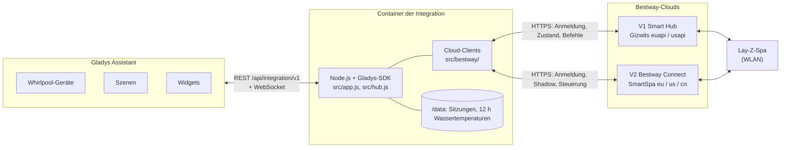
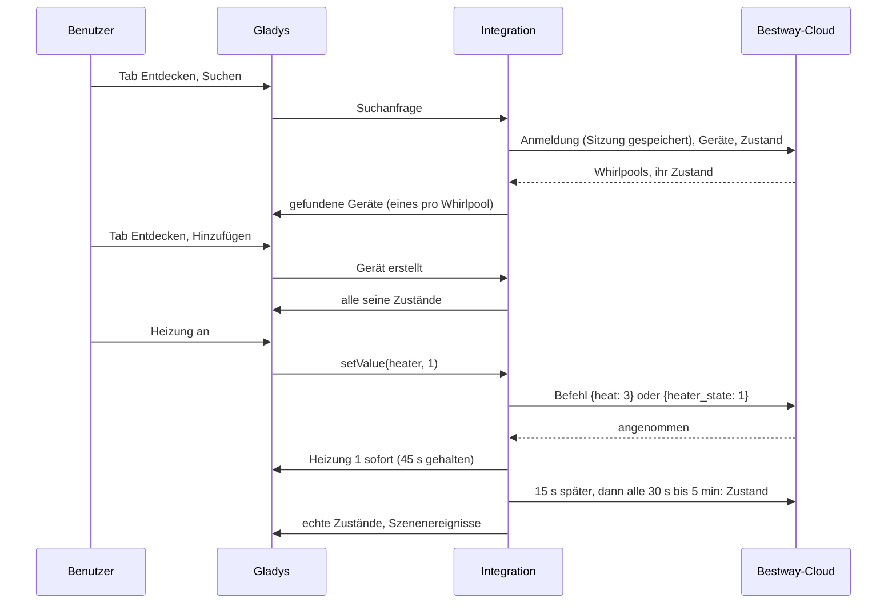
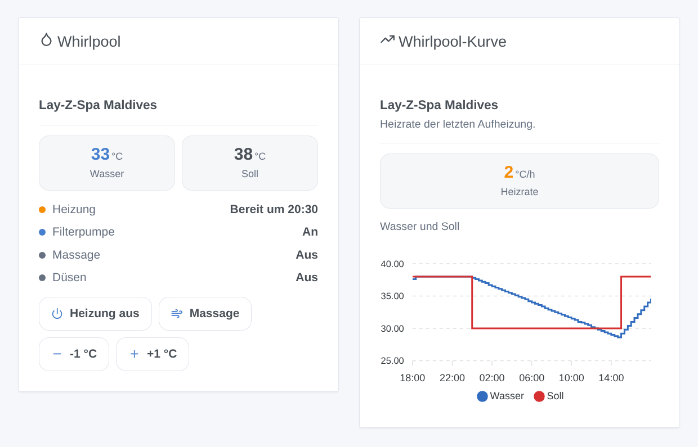

# Bestway Lay-Z-Spa für Gladys Assistant

[English](README.md) | [Français](README.fr.md) | **Deutsch** | [Español](README.es.md)

[](LICENSE)
[](https://github.com/William-De71/gladys-bestway/releases)
[](https://github.com/William-De71/gladys-bestway/actions/workflows/release.yml)
[](https://gladysassistant.com)


Ihr Bestway-WLAN-Whirlpool (Lay-Z-Spa, SaluSpa) in Gladys Assistant, mit dem Konto der Bestway-App, die Sie schon nutzen. Wassertemperatur, Heizung, Filterpumpe, Massage und Düsen werden zu Gladys-Geräten, mit einem Dashboard-Widget, das sagt, wann das Wasser bereit ist, und Szenen wie „Whirlpool freitags um 17 Uhr auf 38 °C heizen“. Inoffiziell, nicht mit Bestway verbunden.

## Funktionen

- **Beide App-Generationen**: **Bestway Smart Hub** (V1, Whirlpools bis etwa 2024, Europa oder USA) und **Bestway Connect** (V2, Whirlpools ab 2025, Europa, USA oder China), mit E-Mail und Passwort der App; beide gleichzeitig, wenn Sie beide haben. Kein Freigabe-QR-Code nötig.
- **Ein Gerät pro Whirlpool**, benannt wie in der App: Wassertemperatur, Solltemperatur (20 bis 40 °C; auf Fahrenheit eingestellte Whirlpools werden umgerechnet), Heizung, heizt gerade, Strom, Filterpumpe, Massage (an / aus, oder aus / mittel / maximal bei den V1-Modellen mit Stufen), HydroJet-Düsen, Tastensperre und Fehler, je nach Modell. Filterpumpen **Flowclear Smart Touch** (V1): Strom, Filter-Timer, Kartusche wechseln, Fehler.
- **Befehle, die sofort wirken**: Der neue Wert erscheint sofort und bleibt, bis die Cloud ihn meldet (die Clouds brauchen 5 bis 30 Sekunden), dann prüft eine Lesung 15 Sekunden später ihn. Die Heizung startet auch die Filterpumpe, wie der Whirlpool selbst.
- **Wann das Wasser bereit ist**: Die Heizrate wird an der Aufheizkurve gemessen und gemerkt; Widget und Szenenaktion geben die Uhrzeit, zu der das Wasser sein Soll erreicht.
- **Zwei Dashboard-Widgets**: der Whirlpool (Wasser, Soll, Heizung und Uhrzeit, Filterpumpe, Massage, Düsen, Fehler, mit Tasten zum Heizen, für die Massage und um das Soll um ein Grad zu ändern) und die Whirlpool-Kurve (Wasser und Soll über 1, 3 oder 7 Tage, Heizrate).
- **Vier Szenenauslöser** (Wasser auf Soll, Fehler, Whirlpool nicht erreichbar, Whirlpool wieder da) und **zwei Szenenaktionen** (Whirlpool auslesen, Whirlpool auf eine Temperatur heizen).
- **Schonend für das Konto**: Die Sitzung wird gespeichert und wiederverwendet, eine abgelehnte Anmeldung wartet 15 Minuten (dann länger) bis zum nächsten Versuch, damit ein falsches Passwort das Konto nie sperren lässt.
- Englisch, Französisch, Deutsch und Spanisch.

## Funktionsweise




**Clouds.** Ein Bestway-Whirlpool spricht nur mit seiner Cloud: Es gibt keine lokale API, die jedes Modell bietet. Die Integration nutzt die beiden Clouds der Apps:

- **V1, App Bestway Smart Hub**: die Gizwits-Cloud (`euapi.gizwits.com` oder `usapi.gizwits.com`). Konten der App „Lay-Z-Spa Wi-Fi“ werden dort nicht angenommen.
- **V2, App Bestway Connect**: das „SmartSpa“-Gateway von Bestway (`smart-spa-eu-app.bestwaycorp.com`, `-us-` oder `-cn-`), mit E-Mail und Passwort der App. Die frühere V2-Kopplung per Freigabe-QR-Code funktioniert seit dem App-Update vom Juli 2026 nicht mehr und wird nicht angeboten.

**Befehle.** Die Clouds nehmen einen Befehl sofort an, melden den neuen Zustand aber 5 bis 30 Sekunden später, und das V2-Gateway antwortet „OK“ auch auf einen Befehl, den es ignoriert: Die Integration zeigt den erwarteten Wert, hält ihn 45 Sekunden, sofern die Cloud ihn nicht früher meldet, und liest den Whirlpool 15 Sekunden nach dem Befehl erneut.




### Geräte und Funktionen

| Gladys-Gerät                                   | Funktionen                                                                                                                                                                                                                                                       |
| ---------------------------------------------- | ---------------------------------------------------------------------------------------------------------------------------------------------------------------------------------------------------------------------------------------------------------------- |
| `spa` — der Name aus der App, oder „Whirlpool“ | `temperature` (°C), `target` (Warmwasser-Soll, 20 bis 40 °C), `heater` (an / aus), `heating` (heizt gerade), `power`, `filter`, `bubbles` (an / aus) oder `bubbles_level` (Auswahl: aus, mittel, max), `jets` (HydroJet), `lock` (Tastensperre), `errors` (Text) |
| `pool_filter` — „Filterpumpe“                  | `power`, `timer` (Stunden), `cartridge` (Text: OK / wechseln), `errors` (Text)                                                                                                                                                                                   |

Welche Funktionen ein Whirlpool bekommt, hängt vom Modell ab:

| Modell (Name in der Cloud)              | App | Massage            | Düsen | Tastensperre |
| --------------------------------------- | --- | ------------------ | ----- | ------------ |
| Airjet (z. B. Milan AirJet Plus)        | V1  | an / aus           | —     | ja           |
| Airjet_V01, UltraFit (z. B. Coronado)   | V1  | aus / mittel / max | —     | —            |
| Hydrojet, Hydrojet_Pro (z. B. Maldives) | V1  | aus / mittel / max | ja    | —            |
| AirJet, UltraFit (z. B. Hollywood)      | V2  | an / aus           | —     | ja           |
| HydroJet (z. B. San Francisco)          | V2  | an / aus           | ja    | —            |

Externe IDs: `ext:<Selektor>:spa:v1-<Gizwits-Geräte-ID>` oder `…:spa:v2-<MAC-Adresse>`, Funktionen `…:<Schlüssel>`.

## Transport

`transports: ["cloud"]`: Der Katalog zeigt das Abzeichen **Cloud**. E-Mail und Passwort bleiben in Gladys; Zustand und Befehle des Whirlpools laufen über die Bestway-Cloud der gewählten Region, per HTTPS. Jedes Gerät meldet **Cloud**, solange die Cloud für es antwortet, und **nicht erreichbar**, wenn der Whirlpool offline ist oder die Cloud nicht antwortet; es gibt weder eine lokale Präferenz noch einen eingeschränkten Modus.

## Widgets



Beide Widgets haben die Einstellung **Whirlpool** (der erste, wenn leer).

- **Whirlpool** (`spa`): Wasser- und Solltemperatur, die Heizung (aus, heizt, „bereit um 20:30“, Temperatur erreicht), die Filterpumpe (oder der Strom, wenn aus), Massage, Düsen, Fehler; Tasten **Heizen** / **Heizung aus**, **Massage** / **Massage aus**, **-1 °C**, **+1 °C**. Filterpumpen: Timer, Strom, Kartusche, Fehler.
- **Whirlpool-Kurve** (`history`, Einstellung `period`: 24 Stunden, 3 oder 7 Tage): Wasser- und Solltemperatur aus dem Verlauf von Gladys (das Gerät muss hinzugefügt sein) und die Heizrate in °C pro Stunde.

## Szenenauslöser und -aktionen

Auslöser (Filter `device`: ein Whirlpool, alle, wenn leer):

- `target_reached` — **Das Wasser erreicht die Solltemperatur**: Die Heizung meldet das Wasser auf Soll. Variablen: `device_name`, `temperature`.
- `error_occurred` — **Der Whirlpool meldet einen Fehler**: ein neuer Fehlercode. Filter: `error_code` (z. B. `E02`). Variablen: `device_name`, `error_code`, `errors` (alle aktuellen Fehler).
- `device_offline` — **Der Whirlpool ist nicht erreichbar**: seit 5 Minuten keine Antwort oder als offline gemeldet.
- `device_online` — **Der Whirlpool antwortet wieder** (nach einem Ereignis „nicht erreichbar“).

Aktionen:

- `read_values` — **Whirlpool auslesen** (`device`): eine frische Lesung. Ausgaben `water_temperature`, `target_temperature`, `heater` (an / aus), `heater_text`, `minutes_to_target`, `ready_at` (z. B. `20:30`), `errors`.
- `heat_to` — **Whirlpool heizen auf** (`device`, `temperature` 20 bis 40 °C): setzt das Soll und schaltet die Heizung ein (mit Strom und Filterpumpe); nichts wird erneut gesendet, wenn es schon so ist. Ausgaben `target_temperature`, `water_temperature`, `minutes_to_target`, `ready_at`.

Beispiele:

- Jeden Freitag um 17 Uhr → **Whirlpool heizen auf** 38 °C → Nachricht senden „Der Whirlpool ist um {{…ready_at}} bereit“.
- **Das Wasser erreicht die Solltemperatur** → Benachrichtigung „Der Whirlpool hat {{triggerEvent.data.temperature}} °C“.
- **Der Whirlpool meldet einen Fehler** → Benachrichtigung „Whirlpool: Fehler {{triggerEvent.data.error_code}}“ (Bedeutung siehe Anleitung des Whirlpools).

## Voraussetzungen

- Gladys Assistant **5.3.0 oder neuer** (Suchbegriffe und Länder des Katalogs, Dashboard-Widgets, Szenenauslöser und -aktionen der Integrationen; ältere Instanzen können die Integration nicht installieren).
- Ein Bestway-WLAN-Whirlpool (oder eine Flowclear-Smart-Touch-Pumpe), **der in der App Bestway Smart Hub oder Bestway Connect funktioniert**, und E-Mail und Passwort dieser App.
- Gladys braucht Internetzugang.

## Installation

- **Aus dem Store**: Integrationen → „Bestway“ suchen → Installieren.
- **Über die URL des Repositorys**: Integrationen → Integration installieren → `https://github.com/William-De71/gladys-bestway` einfügen.
- **Entwicklermodus**: Integrationen → Integration installieren → Entwicklermodus, mit dem Manifest eines Builds (die Zusammenfassung des Workflows „Build and publish image“ zeigt es).

## Konfiguration

| Feld            | Typ    | Standard | Bedeutung                                                         |
| --------------- | ------ | -------- | ----------------------------------------------------------------- |
| `v1_email`      | string | leer     | E-Mail des Kontos Bestway Smart Hub (V1)                          |
| `v1_password`   | secret | —        | sein Passwort                                                     |
| `v1_region`     | select | `eu`     | Region des Kontos: `eu`, `us`                                     |
| `v2_email`      | string | leer     | E-Mail des Kontos Bestway Connect (V2)                            |
| `v2_password`   | secret | —        | sein Passwort                                                     |
| `v2_region`     | select | `eu`     | Region des Kontos: `eu`, `us`, `cn`                               |
| `poll_interval` | select | `60`     | Sekunden zwischen zwei Lesungen: 30, 60, 120, 300                 |
| `language`      | select | `en`     | Sprache der Funktionsnamen, der Textzustände und der Szenenfehler |

Ein Konto zählt, sobald E-Mail und Passwort beide ausgefüllt sind. Schaltfläche der Konfigurationsseite: **Konten testen** (meldet sich an und listet jeden gefundenen Whirlpool mit Modell und Wassertemperatur auf).

## Verwendung

1. Integration installieren, das Konto Ihrer App (V1 oder V2) und seine Region eintragen, speichern, dann **Konten testen** drücken.
2. Den Whirlpool im Tab **Entdecken** hinzufügen.
3. Die Widgets einem Dashboard hinzufügen und Ihre Szenen erstellen.

Die Benutzerdokumentation steht in [docs/de.md](docs/de.md) ([en](docs/en.md), [fr](docs/fr.md), [es](docs/es.md)).

## Grenzen

- **Nie mit einem echten Whirlpool oder Konto getestet**: Alles wird gegen eine simulierte Cloud getestet (ein echter lokaler HTTP-Server, der beide APIs mit ihren bekannten Eigenheiten spricht), gebaut nach dem, was die Home-Assistant-Integration [cdpuk/ha-bestway](https://github.com/cdpuk/ha-bestway) dokumentiert hat; die Endpunkte wurden mit einem unbekannten Konto gegen die echten Clouds geprüft. Rückmeldungen willkommen.
- **Nur Cloud**: ohne Internet keine Steuerung. Die Bestway-Clouds sind keine öffentlichen APIs: Bestway kann sie ohne Vorwarnung ändern.
- Fehlercodes werden so angezeigt, wie der Whirlpool sie meldet (`E02`…); ihre Bedeutung hängt vom Modell ab: siehe Anleitung.
- Das V2-Gateway liest und schreibt die Massage nur als an / aus; die Massagestufen der V2-Modelle, die welche haben, werden nicht angeboten.
- Nicht unterstützt: Timer und Zeitpläne der App, das Ändern der Temperatureinheit des Whirlpools (sie wird gelesen und umgerechnet), die alte V2-Kopplung per QR-Code, lokale Steuerung ohne Cloud.
- Die Uhrzeit „bereit um“ ist eine Schätzung nach der letzten Aufheizung: Wind, Abdeckung und Außentemperatur verändern sie.

## Lokale Entwicklung

```bash
npm install
node scripts/fake-cloud.mjs 8080                 # eine falsche Cloud, falls Sie keinen Whirlpool haben
GLADYS_HOST_API_URL=http://localhost:1443 \
  GLADYS_INTEGRATION_TOKEN=… GLADYS_INTEGRATION_SELECTOR=… \
  BESTWAY_DATA_DIR=./data DEBUG=gladys-integration-sdk node index.js
```

| Variable                                                                         | Standard           | Zweck                                         |
| -------------------------------------------------------------------------------- | ------------------ | --------------------------------------------- |
| `GLADYS_HOST_API_URL`, `GLADYS_INTEGRATION_TOKEN`, `GLADYS_INTEGRATION_SELECTOR` | von Gladys gesetzt | Verbindung zur Host-API von Gladys            |
| `BESTWAY_DATA_DIR`                                                               | `/data`            | Ordner von `sessions.json` und `history.json` |
| `DEBUG`                                                                          | nicht gesetzt      | `gladys-integration-sdk` für die SDK-Logs     |

| Skript                            | Was es tut                                           |
| --------------------------------- | ---------------------------------------------------- |
| `npm test`                        | die Tests (`node --test`), nichts verlässt 127.0.0.1 |
| `npm run lint`                    | ESLint                                               |
| `npm run format` / `format:check` | Prettier                                             |
| `scripts/fake-cloud.mjs`          | die falsche Cloud der Tests starten                  |
| `docs/illustrations/render.sh`    | die Widget-Illustrationen neu erzeugen               |
| `scripts/build-cover.sh`          | `cover.jpg` aus `cover.svg` neu erzeugen             |

## Tests

`npm test` führt die ganze Integration gegen das falsche Gladys des SDK und eine falsche Bestway-Cloud auf einem echten lokalen HTTP-Server aus, mit beiden APIs und ihren Eigenheiten (Fehler als HTTP-400-Codes bei V1, Text-Codes in HTTP 200 bei V2, Content-MD5, ein Befehls-`data`, das ein JSON-String sein muss, als 2 zurückgelesene Werte, verspätet angewendete Befehle, ablaufende Tokens). Abgedeckt: jede Modellfamilie (Lesen, Schreiben, Fahrenheit), beide Clients, Anmeldungen und ihre Pause, die über Neustarts gespeicherte Sitzung, Erkennung, Werte, Befehle und ihr Halten, Ablehnungen, Szenenauslöser und beide Aktionen, beide Widgets geprüft mit `validateWidgetContent` und ihre Tasten, die Heizrate, verlorene und zurückgekehrte Whirlpools. Die Geräte werden gegen die Regeln des Gladys-Kerns und eine Erkennungsreferenz geprüft (externe IDs sind für immer), das Manifest gegen den Code, die Übersetzungen und das Release-Skript. Die CI baut auch das Image und startet es wie Gladys (schreibgeschützt, 256 MB, ohne Netzwerk).

## Release-Prozess

Jeder Merge auf `main` veröffentlicht ein Release, wenn seine Commits es rechtfertigen, ohne manuellen Schritt:

```mermaid
flowchart LR
  A[Merge auf main] --> B[CI: Prettier, ESLint,<br/>Tests, Docker-Build]
  B --> C[nächste Version aus<br/>Conventional Commits]
  C --> D[Abschnitt in CHANGELOG.md]
  D --> E[Commit chore release<br/>+ Tag vX.Y.Z]
  E --> F[Image :X.Y.Z + :latest<br/>amd64 + arm64]
  F --> G[main rückt auf<br/>den Release-Commit]
  G --> H[GitHub Release]
  H --> I[Prüfung: anonymer Pull,<br/>Store-Validator, Topic]
```




- `feat` → Minor, `fix` / `perf` → Patch, `!` oder `BREAKING CHANGE:` → Major (ein Minor unter 1.0.0). `docs`, `chore`, `ci`, `test`, `style`, `refactor`, `build` allein veröffentlichen nichts.
- Der Titel des Pull Requests wird zum Squash-Commit, also zur Changelog-Zeile: auf Englisch, für den Benutzer (`feat(widgets): …`). `pr-title.yml` prüft ihn. `CHANGELOG.md` nie von Hand bearbeiten.
- Das Image existiert, bevor `main` seine Version ankündigt (der Store indexiert `main`).
- 1.0.0 ist eine manuelle Entscheidung: Actions → Release → Run workflow, `release-as: 1.0.0`. `dry-run` zeigt Version und Changelog, ohne zu veröffentlichen.
- **Geschütztes `main`**: Das Release pusht einen Commit auf `main`. Bei einem Branch-Schutz oder Ruleset, das Pull Requests oder Status Checks verlangt, GitHub Actions die Umgehung erlauben (oder eine GitHub App nutzen), sonst stoppt das Release nach dem Image.
- Nach dem ersten Release das Paket bei Bedarf öffentlich machen: Package settings → Change visibility → Public.

## Fehlerbehebung

- **„lehnt E-Mail oder Passwort ab“**: das Konto der App nutzen, mit der Ihr Whirlpool funktioniert (Smart Hub = V1, Bestway Connect = V2), nicht das der App „Lay-Z-Spa Wi-Fi“; die Region prüfen. Nach einer Ablehnung wartet die Integration 15 Minuten bis zur nächsten Anmeldung (dann 30, 60… bis 6 Stunden): Das korrigierte Passwort speichern, es wird sofort genutzt.
- **„verbunden, aber kein Gerät“**: Der Whirlpool ist nicht in diesem Konto oder dieser Region: die andere Region versuchen oder den Whirlpool in der App hinzufügen.
- **Ein Befehl wirkt, dann kehrt kurz der alte Wert zurück**: Die Cloud meldet verspätet; die Lesung 15 Sekunden später zeigt den echten Zustand.
- **Der Whirlpool ist „nicht erreichbar“**: prüfen, ob er in der App funktioniert (WLAN des Whirlpools, Strom).
- **Keine Uhrzeit „bereit um“**: Sie erscheint nach 45 Minuten Heizen und einem Anstieg von 1 °C.
- Logs: der Tab Logs der Integration; `DEBUG=gladys-integration-sdk` für die Details des SDK.

## Mitwirken

Issues und Pull Requests sind willkommen. `npm run format:check`, `npm run lint` und `npm test` ausführen, den Titel des Pull Requests als Conventional Commit schreiben und nach jeder Änderung eines Widget-Inhalts `docs/illustrations/render.sh` ausführen. Eine neue Funktion darf die bestehenden nicht ändern (`test/fixtures/discovery.baseline.json`). Verhält sich ein echter Whirlpool oder eine echte Cloud anders, zuerst die falsche Cloud in `test/helpers/` korrigieren, dann den Code.

## Sicherheit

Siehe [SECURITY.md](SECURITY.md). Das Passwort ist ein Geheimnis der Integrationseinstellungen in Gladys, wird nur per HTTPS an die Bestway-Cloud gesendet und nie geloggt. `/data` speichert das Sitzungstoken jedes Kontos und 12 Stunden Wassertemperaturen: Schützen Sie die Sicherungen von Gladys entsprechend.

## Lizenz

[Apache License 2.0](LICENSE), siehe auch [NOTICE](NOTICE). Die Clients wurden für dieses Projekt nach dem geschrieben, was cdpuk/ha-bestway und TA2k/ioBroker.bestway (MIT) über die beiden Clouds dokumentiert haben; kein Code wurde kopiert. Bestway, Lay-Z-Spa, SaluSpa und Flowclear sind Marken von Bestway Inflatables & Material Corp.; dieses Projekt ist weder mit Bestway verbunden noch von Bestway unterstützt.
