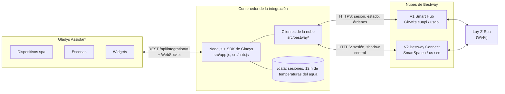
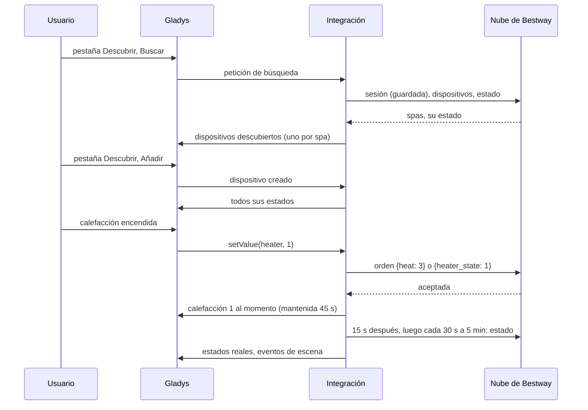
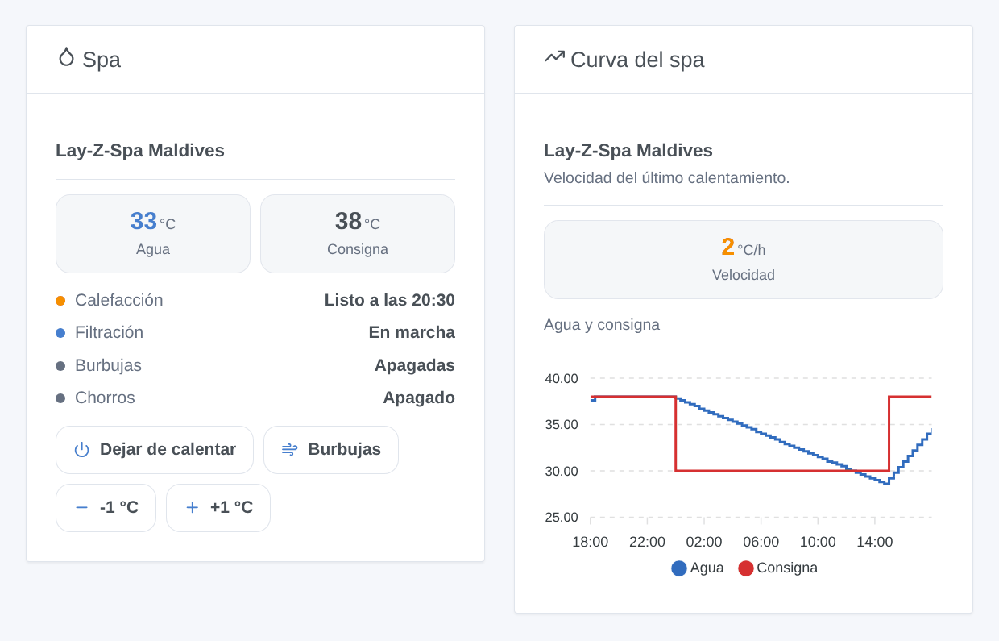
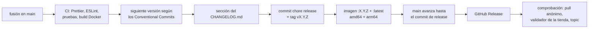

# Bestway Lay-Z-Spa para Gladys Assistant

[English](README.md) | [Français](README.fr.md) | [Deutsch](README.de.md) | **Español**

[](LICENSE)
[](https://github.com/William-De71/gladys-bestway/releases)
[](https://github.com/William-De71/gladys-bestway/actions/workflows/release.yml)
[](https://gladysassistant.com)


Su spa Wi-Fi Bestway (Lay-Z-Spa, SaluSpa) en Gladys Assistant, con la cuenta de la aplicación Bestway que ya usa. La temperatura del agua, la calefacción, la filtración, las burbujas y los chorros se convierten en dispositivos de Gladys, con un widget de panel que indica cuándo estará lista el agua, y escenas como «calentar el spa a 38 °C el viernes a las 17 h». No oficial, sin relación con Bestway.

## Funcionalidades

- **Las dos generaciones de aplicación**: **Bestway Smart Hub** (V1, spas hasta 2024 aproximadamente, Europa o Estados Unidos) y **Bestway Connect** (V2, spas desde 2025, Europa, Estados Unidos o China), con el correo y la contraseña de la aplicación; las dos a la vez si tiene ambas. No hace falta el código QR para compartir.
- **Un dispositivo por spa**, con el nombre de la aplicación: temperatura del agua, temperatura de consigna (20 a 40 °C; los spas en Fahrenheit se convierten), calefacción, calentando ahora, encendido, filtración, burbujas (encendidas / apagadas, o apagadas / medio / máximo en los modelos V1 con niveles), chorros HydroJet, bloqueo del panel y errores, según el modelo. Bombas de filtración **Flowclear Smart Touch** (V1): encendido, temporizador de filtración, cartucho que cambiar, errores.
- **Órdenes que responden al momento**: el nuevo valor se muestra enseguida y se mantiene hasta que la nube lo confirma (las nubes tardan de 5 a 30 segundos), y una lectura 15 segundos después lo comprueba. Encender la calefacción arranca también la filtración, como hace el spa.
- **Cuándo estará lista el agua**: la velocidad de calentamiento se mide en la curva de calentamiento y se recuerda; el widget y la acción de escena dan la hora en que el agua alcanza su consigna.
- **Dos widgets de panel**: el spa (agua, consigna, calefacción y hora, filtración, burbujas, chorros, errores, con botones para calentar, para las burbujas y para cambiar la consigna un grado) y la curva del spa (agua y consigna en 1, 3 o 7 días, velocidad de calentamiento).
- **Cuatro activadores de escena** (agua a la consigna, error, spa inaccesible, spa de vuelta) y **dos acciones de escena** (leer el spa, calentar el spa a una temperatura).
- **Cuidadosa con la cuenta**: la sesión se guarda y se reutiliza, un inicio de sesión rechazado espera 15 minutos (luego más) antes del siguiente intento, así una contraseña errónea nunca hace bloquear la cuenta.
- Inglés, francés, alemán y español.

## Funcionamiento




**Nubes.** Un spa Bestway solo habla con su nube: no existe una API local común a todos los modelos. La integración usa las dos nubes de las aplicaciones:

- **V1, aplicación Bestway Smart Hub**: la nube Gizwits (`euapi.gizwits.com` o `usapi.gizwits.com`). Las cuentas de la aplicación «Lay-Z-Spa Wi-Fi» no se aceptan allí.
- **V2, aplicación Bestway Connect**: la pasarela «SmartSpa» de Bestway (`smart-spa-eu-app.bestwaycorp.com`, `-us-` o `-cn-`), con el correo y la contraseña de la aplicación. El antiguo emparejamiento V2 por código QR para compartir dejó de funcionar con la actualización de la aplicación de julio de 2026 y no se ofrece.

**Órdenes.** Las nubes aceptan una orden al momento pero indican el nuevo estado de 5 a 30 segundos después, y la pasarela V2 responde «OK» incluso a una orden que ignora: la integración muestra el valor esperado, lo mantiene 45 segundos salvo que la nube lo indique antes, y vuelve a leer el spa 15 segundos después de la orden.




### Dispositivos y funcionalidades

| Dispositivo de Gladys                       | Funcionalidades                                                                                                                                                                                                                                                                                             |
| ------------------------------------------- | ----------------------------------------------------------------------------------------------------------------------------------------------------------------------------------------------------------------------------------------------------------------------------------------------------------- |
| `spa` — el nombre de la aplicación, o «Spa» | `temperature` (°C), `target` (consigna del calentador, 20 a 40 °C), `heater` (encendida / apagada), `heating` (calentando ahora), `power`, `filter`, `bubbles` (encendidas / apagadas) o `bubbles_level` (selección: apagadas, medio, máx), `jets` (HydroJet), `lock` (bloqueo del panel), `errors` (texto) |
| `pool_filter` — «Bomba de filtración»       | `power`, `timer` (horas), `cartridge` (texto: correcto / cambiar), `errors` (texto)                                                                                                                                                                                                                         |

Las funcionalidades de un spa dependen de su modelo:

| Modelo (nombre en la nube)               | App | Burbujas               | Chorros | Bloqueo |
| ---------------------------------------- | --- | ---------------------- | ------- | ------- |
| Airjet (p. ej. Milan AirJet Plus)        | V1  | encendidas / apagadas  | —       | sí      |
| Airjet_V01, UltraFit (p. ej. Coronado)   | V1  | apagadas / medio / máx | —       | —       |
| Hydrojet, Hydrojet_Pro (p. ej. Maldives) | V1  | apagadas / medio / máx | sí      | —       |
| AirJet, UltraFit (p. ej. Hollywood)      | V2  | encendidas / apagadas  | —       | sí      |
| HydroJet (p. ej. San Francisco)          | V2  | encendidas / apagadas  | sí      | —       |

Identificadores externos: `ext:<selector>:spa:v1-<id. de Gizwits>` o `…:spa:v2-<dirección MAC>`, funcionalidades `…:<clave>`.

## Transporte

`transports: ["cloud"]`: el catálogo muestra la insignia **nube**. El correo y la contraseña se quedan en Gladys; el estado y las órdenes del spa pasan por la nube de Bestway de la región elegida, en HTTPS. Cada dispositivo publica **nube** mientras la nube responde por él e **inaccesible** cuando el spa está sin conexión o la nube no responde; no hay preferencia local que elegir ni modo degradado.

## Widgets



Los dos widgets tienen un ajuste **Spa** (el primero si está vacío).

- **Spa** (`spa`): temperaturas del agua y de consigna, la calefacción (apagada, calentando, «listo a las 20:30», temperatura alcanzada), la filtración (o el encendido cuando está apagado), burbujas, chorros, errores; botones **Calentar** / **Dejar de calentar**, **Burbujas** / **Parar burbujas**, **-1 °C**, **+1 °C**. Bombas de filtración: temporizador, encendido, cartucho, errores.
- **Curva del spa** (`history`, ajuste `period`: 24 horas, 3 o 7 días): temperaturas del agua y de consigna del historial de Gladys (el dispositivo debe estar añadido) y la velocidad de calentamiento en °C por hora.

## Activadores y acciones de escena

Activadores (filtro `device`: un spa, cualquiera si está vacío):

- `target_reached` — **El agua del spa alcanza su consigna**: la calefacción indica el agua a su consigna. Variables: `device_name`, `temperature`.
- `error_occurred` — **El spa indica un error**: un nuevo código de error. Filtro: `error_code` (p. ej. `E02`). Variables: `device_name`, `error_code`, `errors` (todos los errores actuales).
- `device_offline` — **El spa es inaccesible**: sin respuesta, o indicado sin conexión, desde hace 5 minutos.
- `device_online` — **El spa responde de nuevo** (tras un evento «inaccesible»).

Acciones:

- `read_values` — **Leer el spa** (`device`): una lectura reciente. Salidas `water_temperature`, `target_temperature`, `heater` (encendida o no), `heater_text`, `minutes_to_target`, `ready_at` (p. ej. `20:30`), `errors`.
- `heat_to` — **Calentar el spa a** (`device`, `temperature` de 20 a 40 °C): fija la consigna y enciende la calefacción (con el encendido y la filtración); no se vuelve a enviar nada si ya es así. Salidas `target_temperature`, `water_temperature`, `minutes_to_target`, `ready_at`.

Ejemplos:

- Cada viernes a las 17 h → **Calentar el spa a** 38 °C → enviar un mensaje «El spa estará listo a las {{…ready_at}}».
- **El agua del spa alcanza su consigna** → enviar una notificación «El spa está a {{triggerEvent.data.temperature}} °C».
- **El spa indica un error** → enviar una notificación «Spa: error {{triggerEvent.data.error_code}}» (vea el manual del spa para su significado).

## Requisitos

- Gladys Assistant **5.3.0 o posterior** (palabras clave y países del catálogo, widgets de panel, activadores y acciones de escena de las integraciones; las instancias más antiguas no pueden instalar la integración).
- Un spa Wi-Fi Bestway (o una bomba Flowclear Smart Touch) **que funcione en la aplicación Bestway Smart Hub o Bestway Connect**, y el correo y la contraseña de esa aplicación.
- Gladys debe tener acceso a Internet.

## Instalación

- **Desde la tienda**: Integraciones → buscar «Bestway» → Instalar.
- **Desde la URL del repositorio**: Integraciones → Instalar una integración → pegar `https://github.com/William-De71/gladys-bestway`.
- **Modo desarrollador**: Integraciones → Instalar una integración → Modo desarrollador, con el manifiesto de una compilación (el resumen del workflow «Build and publish image» lo muestra).

## Configuración

| Campo           | Tipo   | Por defecto | Significado                                                                                |
| --------------- | ------ | ----------- | ------------------------------------------------------------------------------------------ |
| `v1_email`      | string | vacío       | correo de la cuenta Bestway Smart Hub (V1)                                                 |
| `v1_password`   | secret | —           | su contraseña                                                                              |
| `v1_region`     | select | `eu`        | región de la cuenta: `eu`, `us`                                                            |
| `v2_email`      | string | vacío       | correo de la cuenta Bestway Connect (V2)                                                   |
| `v2_password`   | secret | —           | su contraseña                                                                              |
| `v2_region`     | select | `eu`        | región de la cuenta: `eu`, `us`, `cn`                                                      |
| `poll_interval` | select | `60`        | segundos entre dos lecturas: 30, 60, 120, 300                                              |
| `language`      | select | `en`        | idioma de los nombres de las funciones, de los estados de texto y de los errores de escena |

Una cuenta cuenta en cuanto su correo y su contraseña están rellenados. Botón de la página de configuración: **Probar las cuentas** (inicia sesión y lista cada spa encontrado, con su modelo y la temperatura del agua).

## Uso

1. Instale la integración, indique la cuenta de su aplicación (V1 o V2) y su región, guarde y pulse **Probar las cuentas**.
2. Añada el spa desde la pestaña **Descubrir**.
3. Añada los widgets a un panel y cree sus escenas.

La documentación de usuario está en [docs/es.md](docs/es.md) ([en](docs/en.md), [fr](docs/fr.md), [de](docs/de.md)).

## Límites

- **Nunca probada con un spa ni una cuenta reales**: todo se prueba contra una nube simulada (un verdadero servidor HTTP local que habla las dos API con sus particularidades conocidas), construida a partir de lo que documentó la integración de Home Assistant [cdpuk/ha-bestway](https://github.com/cdpuk/ha-bestway); las direcciones se comprobaron en las nubes reales con una cuenta desconocida. Se agradecen los comentarios.
- **Solo nube**: sin Internet no hay control. Las nubes de Bestway no son API públicas: Bestway puede cambiarlas sin aviso.
- Los códigos de error se muestran tal como los da el spa (`E02`…); su significado depende del modelo: vea su manual.
- La pasarela V2 lee y escribe las burbujas solo como encendidas / apagadas; los niveles de burbujas de los modelos V2 que los tienen no se ofrecen.
- No gestionado: los temporizadores y programaciones de la aplicación, el cambio de unidad de temperatura del spa (se lee y se convierte), el antiguo emparejamiento V2 por código QR, el control local sin la nube.
- La hora en que el agua estará lista es una estimación según el último calentamiento: el viento, la cubierta y la temperatura exterior la cambian.

## Desarrollo local

```bash
npm install
node scripts/fake-cloud.mjs 8080                 # una nube falsa, si no tiene spa
GLADYS_HOST_API_URL=http://localhost:1443 \
  GLADYS_INTEGRATION_TOKEN=… GLADYS_INTEGRATION_SELECTOR=… \
  BESTWAY_DATA_DIR=./data DEBUG=gladys-integration-sdk node index.js
```

| Variable                                                                         | Por defecto       | Uso                                            |
| -------------------------------------------------------------------------------- | ----------------- | ---------------------------------------------- |
| `GLADYS_HOST_API_URL`, `GLADYS_INTEGRATION_TOKEN`, `GLADYS_INTEGRATION_SELECTOR` | fijado por Gladys | conexión a la API host de Gladys               |
| `BESTWAY_DATA_DIR`                                                               | `/data`           | carpeta de `sessions.json` y `history.json`    |
| `DEBUG`                                                                          | sin definir       | `gladys-integration-sdk` para los logs del SDK |

| Script                            | Qué hace                                            |
| --------------------------------- | --------------------------------------------------- |
| `npm test`                        | las pruebas (`node --test`), nada sale de 127.0.0.1 |
| `npm run lint`                    | ESLint                                              |
| `npm run format` / `format:check` | Prettier                                            |
| `scripts/fake-cloud.mjs`          | lanzar la nube falsa de las pruebas                 |
| `docs/illustrations/render.sh`    | regenerar las ilustraciones de los widgets          |
| `scripts/build-cover.sh`          | regenerar `cover.jpg` a partir de `cover.svg`       |

## Pruebas

`npm test` ejecuta toda la integración contra el Gladys falso del SDK y una nube Bestway falsa en un verdadero servidor HTTP local, con las dos API y sus particularidades (errores como códigos HTTP 400 en V1, códigos de texto en un HTTP 200 en V2, Content-MD5, un `data` de orden que debe ser una cadena JSON, valores releídos como 2, órdenes aplicadas con retraso, tokens que caducan). Cubierto: cada familia de modelos (lectura, escritura, Fahrenheit), los dos clientes, los inicios de sesión y su pausa, la sesión guardada entre reinicios, el descubrimiento, los valores, las órdenes y su mantenimiento, los rechazos, los activadores y las dos acciones de escena, los dos widgets validados por `validateWidgetContent` y sus botones, la velocidad de calentamiento, los spas perdidos y recuperados. Los dispositivos se comprueban con las reglas del núcleo de Gladys y una referencia de descubrimiento (los identificadores externos son para siempre), el manifiesto con el código, las traducciones y el script de publicación. La CI también construye la imagen y la arranca como Gladys (solo lectura, 256 MB, sin red).

## Proceso de publicación

Cada fusión en `main` publica una versión cuando sus commits lo justifican, sin ningún paso manual:




- `feat` → menor, `fix` / `perf` → parche, `!` o `BREAKING CHANGE:` → mayor (una menor antes de 1.0.0). `docs`, `chore`, `ci`, `test`, `style`, `refactor`, `build` solos no publican nada.
- El título de la pull request se convierte en el commit squash, es decir, en la línea del changelog: escríbalo en inglés, para el usuario (`feat(widgets): …`). `pr-title.yml` lo comprueba. No edite nunca `CHANGELOG.md` a mano.
- La imagen existe antes de que `main` anuncie su versión (la tienda indexa `main`).
- 1.0.0 es una decisión manual: Actions → Release → Run workflow, `release-as: 1.0.0`. `dry-run` muestra la versión y el changelog sin publicar.
- **`main` protegida**: la publicación empuja un commit a `main`. Con una protección de rama o un ruleset que exija pull requests o status checks, permita a GitHub Actions saltársela (o use una GitHub App), si no la publicación se detiene tras la imagen.
- Tras la primera publicación, haga público el paquete si hace falta: Package settings → Change visibility → Public.

## Solución de problemas

- **«rechaza el correo o la contraseña»**: use la cuenta de la aplicación con la que funciona su spa (Smart Hub = V1, Bestway Connect = V2), no la de la aplicación «Lay-Z-Spa Wi-Fi»; compruebe la región. Tras un rechazo la integración espera 15 minutos antes del siguiente inicio de sesión (luego 30, 60… hasta 6 horas): guarde la contraseña corregida, se usa al momento.
- **«conectada, pero sin dispositivos»**: el spa no está en esta cuenta o en esta región: pruebe la otra región o añada el spa en la aplicación.
- **Una orden surte efecto y luego vuelve un momento el valor antiguo**: la nube informa con retraso; la lectura 15 segundos después muestra el estado real.
- **El spa está «inaccesible»**: compruebe que funciona en la aplicación (Wi-Fi del spa, corriente).
- **Sin hora «listo a las»**: aparece tras 45 minutos de calentamiento y una subida de 1 °C.
- Logs: la pestaña Logs de la integración; `DEBUG=gladys-integration-sdk` para el detalle del SDK.

## Contribuir

Las issues y pull requests son bienvenidas. Ejecute `npm run format:check`, `npm run lint` y `npm test`, escriba el título de la pull request como Conventional Commit y ejecute `docs/illustrations/render.sh` tras cualquier cambio en el contenido de un widget. Una nueva funcionalidad no debe cambiar las existentes (`test/fixtures/discovery.baseline.json`). Cuando un spa o una nube reales se comportan de otro modo, corrija primero la nube falsa de `test/helpers/`, luego el código.

## Seguridad

Vea [SECURITY.md](SECURITY.md). La contraseña es un secreto de los ajustes de la integración en Gladys, enviado solo a la nube de Bestway en HTTPS y nunca escrito en los logs. `/data` guarda el token de sesión de cada cuenta y 12 horas de temperaturas del agua: proteja las copias de seguridad de Gladys en consecuencia.

## Licencia

[Licencia Apache 2.0](LICENSE), vea también [NOTICE](NOTICE). Los clientes se escribieron para este proyecto a partir de lo que cdpuk/ha-bestway y TA2k/ioBroker.bestway (MIT) documentaron de las dos nubes; no se copió código. Bestway, Lay-Z-Spa, SaluSpa y Flowclear son marcas de Bestway Inflatables & Material Corp.; este proyecto no está afiliado a Bestway ni respaldado ni apoyado por Bestway.
