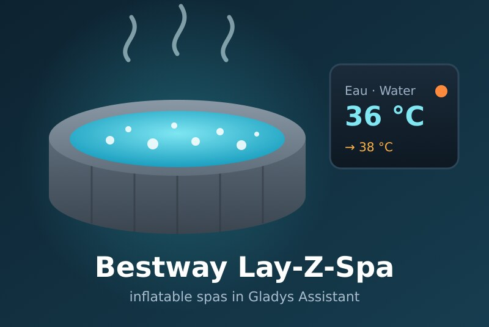
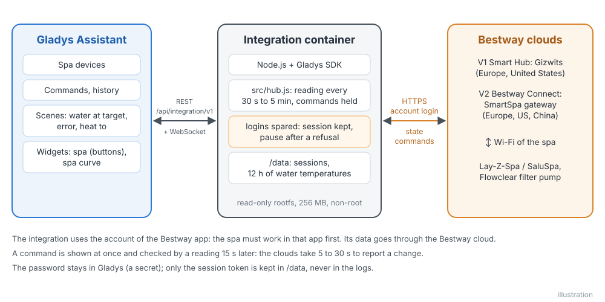
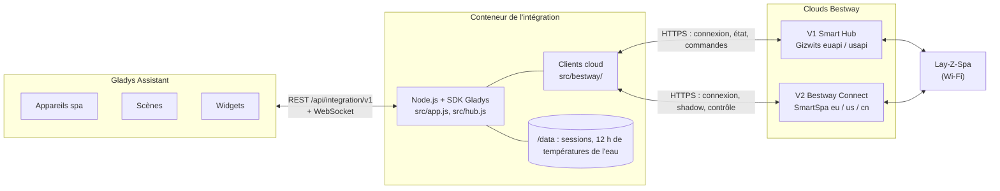
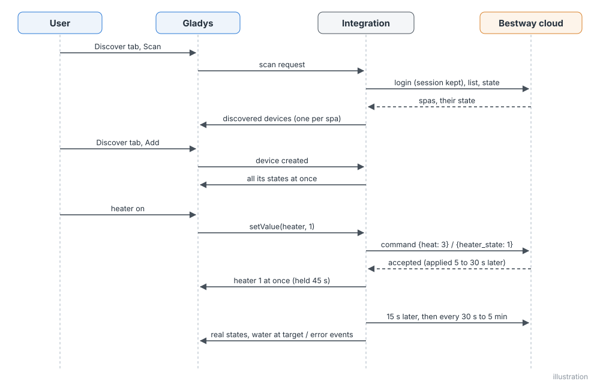
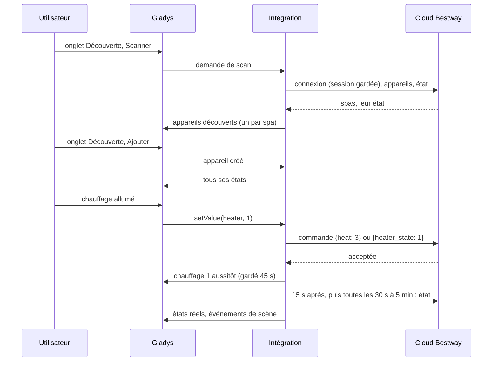
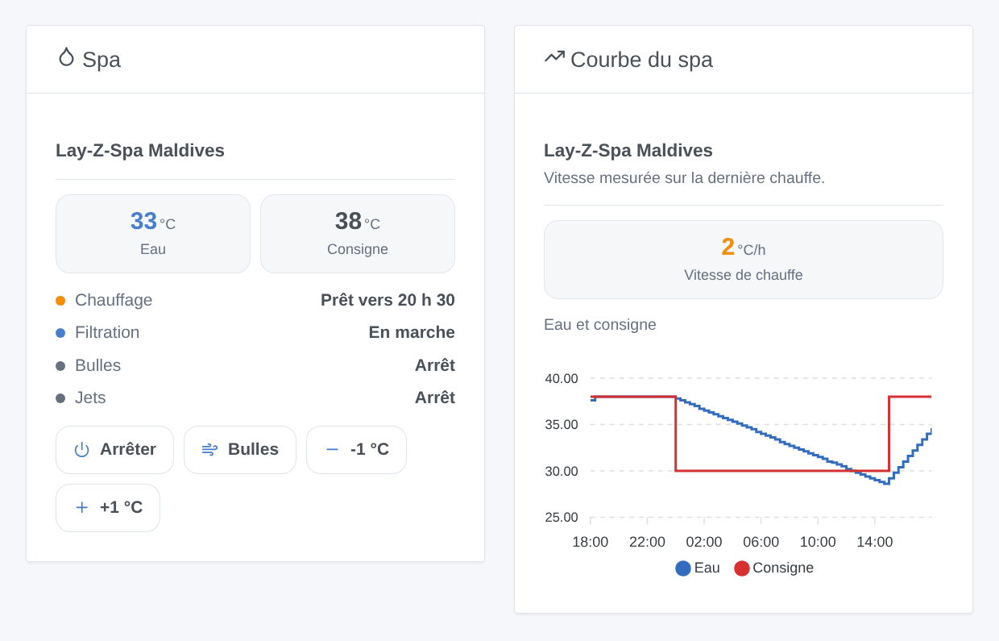
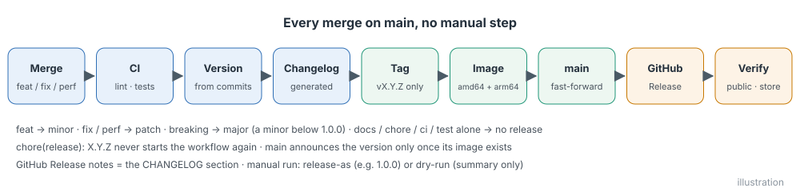

# Bestway Lay-Z-Spa pour Gladys Assistant

[English](README.md) | **Français** | [Deutsch](README.de.md) | [Español](README.es.md)

[](LICENSE)
[](https://github.com/William-De71/gladys-bestway/releases)
[](https://github.com/William-De71/gladys-bestway/actions/workflows/release.yml)
[](https://gladysassistant.com)



Votre spa Wi-Fi Bestway (Lay-Z-Spa, SaluSpa) dans Gladys Assistant, avec le compte de l'application Bestway que vous utilisez déjà. Température de l'eau, chauffage, filtration, bulles et jets deviennent des appareils Gladys, avec un widget de tableau de bord qui annonce l'heure où l'eau sera prête, et des scènes du genre « chauffer le spa à 38 °C le vendredi à 17 h ». Non officielle, sans lien avec Bestway.

## Fonctionnalités

- **Les deux générations d'application** : **Bestway Smart Hub** (V1, spas jusqu'à 2024 environ, Europe ou États-Unis) et **Bestway Connect** (V2, spas depuis 2025, Europe, États-Unis ou Chine), avec l'e-mail et le mot de passe de l'application ; les deux à la fois si vous avez les deux. Pas besoin de QR code de partage.
- **Un appareil par spa**, nommé comme dans l'application : température de l'eau, température de consigne (20 à 40 °C ; les spas réglés en Fahrenheit sont convertis), chauffage, chauffe en cours, alimentation, filtration, bulles (marche / arrêt, ou arrêt / moyen / maximum sur les modèles V1 qui ont des niveaux), jets HydroJet, verrouillage du panneau et erreurs, selon le modèle. Pompes de filtration **Flowclear Smart Touch** (V1) : alimentation, minuterie de filtration, cartouche à changer, erreurs.
- **Des commandes qui répondent tout de suite** : la nouvelle valeur s'affiche aussitôt et reste affichée jusqu'à ce que le cloud la confirme (les clouds mettent 5 à 30 secondes), puis une lecture 15 secondes plus tard la vérifie. Allumer le chauffage démarre aussi la filtration, comme le fait le spa.
- **L'heure où l'eau sera prête** : la vitesse de chauffe est mesurée sur la courbe de chauffe et mémorisée ; le widget et l'action de scène donnent l'heure où l'eau atteint sa consigne.
- **Deux widgets de tableau de bord** : le spa (eau, consigne, chauffage et heure de fin, filtration, bulles, jets, erreurs, avec des boutons pour chauffer, pour les bulles et pour changer la consigne d'un degré) et la courbe du spa (eau et consigne sur 1, 3 ou 7 jours, vitesse de chauffe).
- **Quatre déclencheurs de scène** (eau à la consigne, erreur, spa injoignable, spa revenu) et **deux actions de scène** (lire le spa, chauffer le spa à une température).
- **Respectueuse du compte** : la session est gardée et réutilisée, une connexion refusée attend 15 minutes (puis plus) avant le prochain essai, si bien qu'un mauvais mot de passe ne fait jamais bloquer le compte.
- Anglais, français, allemand et espagnol.

## Fonctionnement





**Clouds.** Un spa Bestway ne parle qu'à son cloud : il n'existe pas d'API locale commune à tous les modèles. L'intégration utilise les deux clouds des applications :

- **V1, application Bestway Smart Hub** : le cloud Gizwits (`euapi.gizwits.com` ou `usapi.gizwits.com`). Les comptes de l'application « Lay-Z-Spa Wi-Fi » n'y sont pas acceptés.
- **V2, application Bestway Connect** : la passerelle « SmartSpa » de Bestway (`smart-spa-eu-app.bestwaycorp.com`, `-us-` ou `-cn-`), avec l'e-mail et le mot de passe de l'application. L'ancienne association V2 par QR code de partage ne fonctionne plus depuis la mise à jour de l'application de juillet 2026 et n'est pas proposée.

**Commandes.** Les clouds acceptent une commande tout de suite mais signalent le nouvel état 5 à 30 secondes plus tard, et la passerelle V2 répond « OK » même à une commande qu'elle ignore : l'intégration affiche la valeur attendue, la garde 45 secondes sauf si le cloud la signale avant, et relit le spa 15 secondes après la commande.





### Appareils et fonctionnalités

| Appareil Gladys                             | Fonctionnalités                                                                                                                                                                                                                                                                                      |
| ------------------------------------------- | ---------------------------------------------------------------------------------------------------------------------------------------------------------------------------------------------------------------------------------------------------------------------------------------------------- |
| `spa` — le nom de l'application, ou « Spa » | `temperature` (°C), `target` (consigne du chauffe-eau, 20 à 40 °C), `heater` (marche / arrêt), `heating` (chauffe en cours), `power`, `filter`, `bubbles` (marche / arrêt) ou `bubbles_level` (sélection : arrêt, moyen, max), `jets` (HydroJet), `lock` (verrouillage du panneau), `errors` (texte) |
| `pool_filter` — « Pompe de filtration »     | `power`, `timer` (heures), `cartridge` (texte : OK / à changer), `errors` (texte)                                                                                                                                                                                                                    |

Les fonctionnalités d'un spa dépendent de son modèle :

| Modèle (nom dans le cloud)                | Appli | Bulles              | Jets | Verrouillage |
| ----------------------------------------- | ----- | ------------------- | ---- | ------------ |
| Airjet (par ex. Milan AirJet Plus)        | V1    | marche / arrêt      | —    | oui          |
| Airjet_V01, UltraFit (par ex. Coronado)   | V1    | arrêt / moyen / max | —    | —            |
| Hydrojet, Hydrojet_Pro (par ex. Maldives) | V1    | arrêt / moyen / max | oui  | —            |
| AirJet, UltraFit (par ex. Hollywood)      | V2    | marche / arrêt      | —    | oui          |
| HydroJet (par ex. San Francisco)          | V2    | marche / arrêt      | oui  | —            |

Identifiants externes : `ext:<sélecteur>:spa:v1-<identifiant Gizwits>` ou `…:spa:v2-<adresse MAC>`, fonctionnalités `…:<clé>`.

## Transport

`transports: ["cloud"]` : le catalogue affiche le badge **cloud**. L'e-mail et le mot de passe restent dans Gladys ; l'état et les commandes du spa passent par le cloud Bestway de la région choisie, en HTTPS. Chaque appareil publie **cloud** tant que le cloud répond pour lui et **injoignable** quand le spa est hors ligne ou que le cloud ne répond pas ; il n'y a ni préférence locale à choisir, ni mode dégradé.

## Widgets



Les deux widgets ont un réglage **Spa** (le premier si vide).

- **Spa** (`spa`) : températures de l'eau et de consigne, le chauffage (arrêt, chauffe, « prêt vers 20 h 30 », température atteinte), la filtration (ou l'alimentation quand elle est coupée), les bulles, les jets, les erreurs ; boutons **Chauffer** / **Arrêter**, **Bulles** / **Couper les bulles**, **-1 °C**, **+1 °C**. Pompes de filtration : minuterie, alimentation, cartouche, erreurs.
- **Courbe du spa** (`history`, réglage `period` : 24 heures, 3 ou 7 jours) : températures de l'eau et de consigne tirées de l'historique de Gladys (l'appareil doit être ajouté), et la vitesse de chauffe en °C par heure.

## Déclencheurs et actions de scène

Déclencheurs (filtre `device` : un spa, tous si vide) :

- `target_reached` — **L'eau du spa atteint sa consigne** : le chauffage signale l'eau à sa consigne. Variables : `device_name`, `temperature`.
- `error_occurred` — **Le spa signale une erreur** : un nouveau code d'erreur. Filtre : `error_code` (par ex. `E02`). Variables : `device_name`, `error_code`, `errors` (toutes les erreurs en cours).
- `device_offline` — **Le spa est injoignable** : pas de réponse, ou signalé hors ligne, depuis 5 minutes.
- `device_online` — **Le spa répond à nouveau** (après un événement « injoignable »).

Actions :

- `read_values` — **Lire le spa** (`device`) : une lecture fraîche. Sorties `water_temperature`, `target_temperature`, `heater` (allumé ou non), `heater_text`, `minutes_to_target`, `ready_at` (par ex. `20 h 30`), `errors`.
- `heat_to` — **Chauffer le spa à** (`device`, `temperature` de 20 à 40 °C) : règle la consigne et allume le chauffage (avec l'alimentation et la filtration) ; rien n'est renvoyé si c'est déjà le cas. Sorties `target_temperature`, `water_temperature`, `minutes_to_target`, `ready_at`.

Exemples :

- Chaque vendredi à 17 h → **Chauffer le spa à** 38 °C → envoyer un message « Le spa sera prêt vers {{…ready_at}} ».
- **L'eau du spa atteint sa consigne** → envoyer une notification « Le spa est à {{triggerEvent.data.temperature}} °C ».
- **Le spa signale une erreur** → envoyer une notification « Spa : erreur {{triggerEvent.data.error_code}} » (voir la notice du spa pour sa signification).

## Prérequis

- Gladys Assistant **5.1.0 ou plus récent** (widgets de tableau de bord, déclencheurs et actions de scène des intégrations ; les instances plus anciennes ne peuvent pas installer l'intégration).
- Un spa Wi-Fi Bestway (ou une pompe Flowclear Smart Touch) **qui fonctionne dans l'application Bestway Smart Hub ou Bestway Connect**, et l'e-mail et le mot de passe de cette application.
- Gladys doit avoir accès à Internet.

## Installation

- **Depuis le store** : Intégrations → chercher « Bestway » → Installer.
- **Depuis l'URL du dépôt** : Intégrations → Installer une intégration → coller `https://github.com/William-De71/gladys-bestway`.
- **Mode développeur** : Intégrations → Installer une intégration → Mode développeur, avec le manifeste d'un build (le résumé du workflow « Build and publish image » l'affiche).

## Configuration

| Champ           | Type   | Défaut | Rôle                                                                         |
| --------------- | ------ | ------ | ---------------------------------------------------------------------------- |
| `v1_email`      | string | vide   | e-mail du compte Bestway Smart Hub (V1)                                      |
| `v1_password`   | secret | —      | son mot de passe                                                             |
| `v1_region`     | select | `eu`   | région du compte : `eu`, `us`                                                |
| `v2_email`      | string | vide   | e-mail du compte Bestway Connect (V2)                                        |
| `v2_password`   | secret | —      | son mot de passe                                                             |
| `v2_region`     | select | `eu`   | région du compte : `eu`, `us`, `cn`                                          |
| `poll_interval` | select | `60`   | secondes entre deux lectures : 30, 60, 120, 300                              |
| `language`      | select | `en`   | langue des noms des fonctionnalités, des états texte et des erreurs de scène |

Un compte compte dès que son e-mail et son mot de passe sont tous deux renseignés. Bouton de la page de configuration : **Tester les comptes** (se connecte et liste chaque spa trouvé, avec son modèle et la température de son eau).

## Utilisation

1. Installez l'intégration, renseignez le compte de votre application (V1 ou V2) et sa région, enregistrez, puis appuyez sur **Tester les comptes**.
2. Ajoutez le spa depuis l'onglet **Découverte**.
3. Ajoutez les widgets à un tableau de bord et créez vos scènes.

La documentation utilisateur est dans [docs/fr.md](docs/fr.md) ([en](docs/en.md), [de](docs/de.md), [es](docs/es.md)).

## Limites

- **Jamais testée avec un vrai spa ni un vrai compte** : tout est testé contre un cloud simulé (un vrai serveur HTTP local qui parle les deux API avec leurs particularités connues), construit d'après ce qu'a documenté l'intégration Home Assistant [cdpuk/ha-bestway](https://github.com/cdpuk/ha-bestway), et les adresses ont été vérifiées sur les vrais clouds avec un compte inconnu. Les retours sont bienvenus.
- **Cloud uniquement** : pas d'Internet, pas de commande. Les clouds Bestway ne sont pas des API publiques : Bestway peut les changer sans prévenir.
- Les codes d'erreur sont affichés tels que le spa les donne (`E02`…) ; leur sens dépend du modèle : voir sa notice.
- La passerelle V2 lit et écrit les bulles en marche / arrêt seulement ; les niveaux de bulles des modèles V2 qui en ont ne sont pas proposés.
- Non géré : les minuteries et programmations de l'application, le changement d'unité de température du spa (elle est lue et convertie), l'ancienne association V2 par QR code, la commande locale sans le cloud.
- L'heure où l'eau sera prête est une estimation d'après la dernière chauffe : le vent, la bâche et la température extérieure la font varier.

## Développement local

```bash
npm install
node scripts/fake-cloud.mjs 8080                 # un faux cloud, si vous n'avez pas de spa
GLADYS_HOST_API_URL=http://localhost:1443 \
  GLADYS_INTEGRATION_TOKEN=… GLADYS_INTEGRATION_SELECTOR=… \
  BESTWAY_DATA_DIR=./data DEBUG=gladys-integration-sdk node index.js
```

| Variable                                                                         | Défaut          | Usage                                         |
| -------------------------------------------------------------------------------- | --------------- | --------------------------------------------- |
| `GLADYS_HOST_API_URL`, `GLADYS_INTEGRATION_TOKEN`, `GLADYS_INTEGRATION_SELECTOR` | fixé par Gladys | connexion à l'API hôte de Gladys              |
| `BESTWAY_DATA_DIR`                                                               | `/data`         | dossier de `sessions.json` et `history.json`  |
| `DEBUG`                                                                          | non défini      | `gladys-integration-sdk` pour les logs du SDK |

| Script                            | Ce qu'il fait                                        |
| --------------------------------- | ---------------------------------------------------- |
| `npm test`                        | les tests (`node --test`), rien ne sort de 127.0.0.1 |
| `npm run lint`                    | ESLint                                               |
| `npm run format` / `format:check` | Prettier                                             |
| `scripts/fake-cloud.mjs`          | lancer le faux cloud des tests                       |
| `docs/illustrations/render.sh`    | régénérer les illustrations des widgets              |
| `scripts/build-cover.sh`          | régénérer `cover.jpg` à partir de `cover.svg`        |

## Tests

`npm test` lance toute l'intégration contre le faux Gladys du SDK et un faux cloud Bestway sur un vrai serveur HTTP local, avec les deux API et leurs particularités (erreurs en codes HTTP 400 en V1, codes texte dans un HTTP 200 en V2, Content-MD5, un `data` de commande qui doit être une chaîne JSON, valeurs relues à 2, commandes appliquées en retard, jetons qui expirent). Couvert : chaque famille de modèles (lecture, écriture, Fahrenheit), les deux clients, les connexions et leur pause, la session gardée d'un redémarrage à l'autre, la découverte, les valeurs, les commandes et leur maintien, les refus, les déclencheurs et les deux actions de scène, les deux widgets validés par `validateWidgetContent` et leurs boutons, la vitesse de chauffe, les spas perdus et revenus. Les appareils sont vérifiés contre les règles du cœur de Gladys et une référence de découverte (les identifiants externes sont éternels), le manifeste contre le code, les traductions et le script de release. La CI construit aussi l'image et la démarre comme Gladys (lecture seule, 256 Mo, sans réseau).

## Processus de release

Chaque fusion sur `main` publie une release quand ses commits le justifient, sans aucune étape manuelle :

```mermaid
flowchart LR
  A[fusion sur main] --> B[CI : Prettier, ESLint,<br/>tests, build Docker]
  B --> C[version suivante d'après<br/>les Conventional Commits]
  C --> D[section du CHANGELOG.md]
  D --> E[commit chore release<br/>+ tag vX.Y.Z]
  E --> F[image :X.Y.Z + :latest<br/>amd64 + arm64]
  F --> G[main avance jusqu'au<br/>commit de release]
  G --> H[GitHub Release]
  H --> I[vérification : pull anonyme,<br/>validateur du store, topic]
```





- `feat` → mineure, `fix` / `perf` → correctif, `!` ou `BREAKING CHANGE:` → majeure (une mineure avant 1.0.0). `docs`, `chore`, `ci`, `test`, `style`, `refactor`, `build` seuls ne publient rien.
- Le titre de la pull request devient le commit squash, donc la ligne du changelog : écrivez-le en anglais, pour l'utilisateur (`feat(widgets): …`). `pr-title.yml` le vérifie. Ne modifiez jamais `CHANGELOG.md` à la main.
- L'image existe avant que `main` annonce sa version (le store indexe `main`).
- 1.0.0 est une décision manuelle : Actions → Release → Run workflow, `release-as: 1.0.0`. `dry-run` montre la version et le changelog sans rien publier.
- **`main` protégée** : la release pousse un commit sur `main`. Avec une protection de branche ou un ruleset qui exige des pull requests ou des status checks, autorisez GitHub Actions à le contourner (ou utilisez une GitHub App), sinon la release s'arrête après l'image.
- Après la première release, rendez le package public si besoin : Package settings → Change visibility → Public.

## Dépannage

- **« refuse l'e-mail ou le mot de passe »** : utilisez le compte de l'application avec laquelle votre spa fonctionne (Smart Hub = V1, Bestway Connect = V2), pas celui de l'application « Lay-Z-Spa Wi-Fi » ; vérifiez la région. Après un refus, l'intégration attend 15 minutes avant la prochaine connexion (puis 30, 60… jusqu'à 6 heures) : enregistrez le mot de passe corrigé, il est utilisé aussitôt.
- **« connecté, mais aucun appareil »** : le spa n'est pas sur ce compte ou dans cette région : essayez l'autre région, ou ajoutez le spa dans l'application.
- **Une commande prend effet, puis l'ancienne valeur revient un instant** : le cloud signale en retard ; la lecture 15 secondes plus tard montre l'état réel.
- **Le spa est « injoignable »** : vérifiez qu'il fonctionne dans l'application (Wi-Fi du spa, courant).
- **Pas d'heure « prêt vers »** : elle apparaît après 45 minutes de chauffe et une hausse de 1 °C.
- Logs : l'onglet Logs de l'intégration ; `DEBUG=gladys-integration-sdk` pour le détail du SDK.

## Contribuer

Les issues et pull requests sont bienvenues. Lancez `npm run format:check`, `npm run lint` et `npm test`, écrivez le titre de la pull request en Conventional Commit, et relancez `docs/illustrations/render.sh` après tout changement d'un contenu de widget. Une nouvelle fonctionnalité ne doit pas modifier les existantes (`test/fixtures/discovery.baseline.json`). Quand un vrai spa ou un vrai cloud se comporte autrement, corrigez d'abord le faux cloud de `test/helpers/`, puis le code.

## Sécurité

Voir [SECURITY.md](SECURITY.md). Le mot de passe est un secret des réglages de l'intégration dans Gladys, envoyé seulement au cloud Bestway en HTTPS et jamais écrit dans les logs. `/data` garde le jeton de session de chaque compte et 12 heures de températures de l'eau : protégez les sauvegardes de Gladys en conséquence.

## Licence

[Licence Apache 2.0](LICENSE), voir aussi [NOTICE](NOTICE). Les clients ont été écrits pour ce projet d'après ce que cdpuk/ha-bestway et TA2k/ioBroker.bestway (MIT) ont documenté des deux clouds ; aucun code n'a été copié. Bestway, Lay-Z-Spa, SaluSpa et Flowclear sont des marques de Bestway Inflatables & Material Corp. ; ce projet n'est ni affilié à Bestway, ni approuvé, ni soutenu par Bestway.
