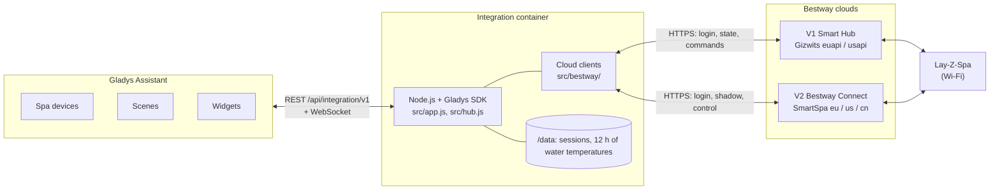
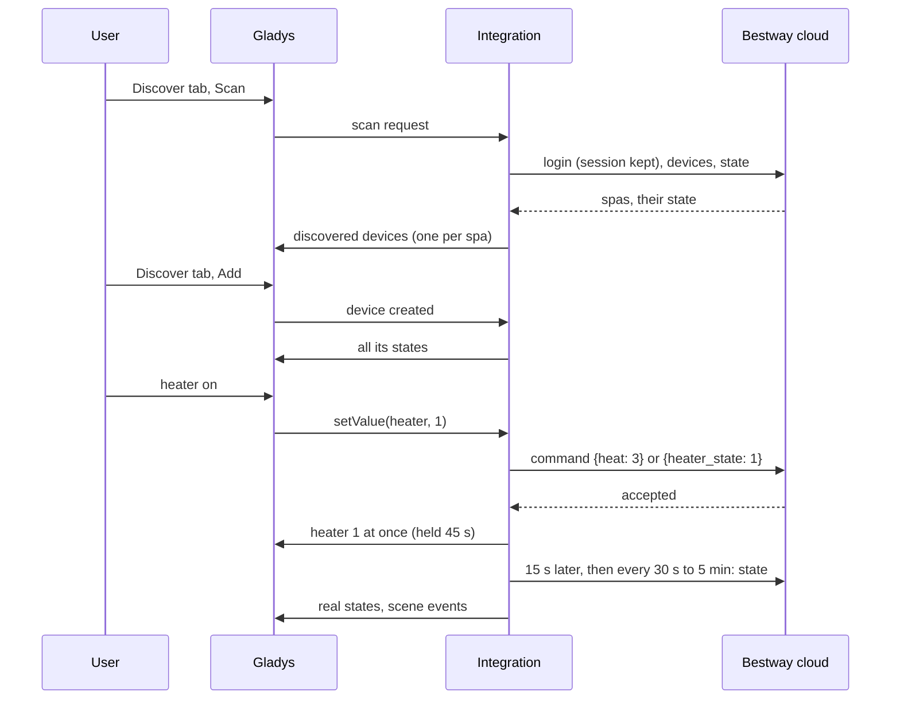
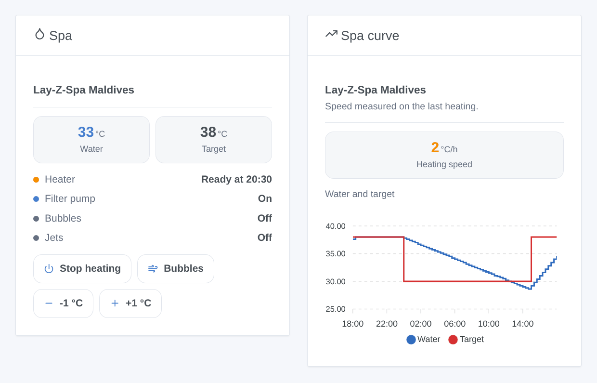

# Bestway Lay-Z-Spa for Gladys Assistant

**English** | [Français](README.fr.md) | [Deutsch](README.de.md) | [Español](README.es.md)

[](LICENSE)
[](https://github.com/William-De71/gladys-bestway/releases)
[](https://github.com/William-De71/gladys-bestway/actions/workflows/release.yml)
[](https://gladysassistant.com)


Your Bestway Wi-Fi spa (Lay-Z-Spa, SaluSpa) in Gladys Assistant, with the account of the Bestway app you already use. Water temperature, heater, filter pump, bubbles and jets become Gladys devices, with a dashboard widget that says when the water will be ready, and scenes such as "heat the spa to 38 °C on Friday at 5 pm". Unofficial, not affiliated with Bestway.

## Features

- **Both app generations**: **Bestway Smart Hub** (V1, spas up to about 2024, Europe or United States) and **Bestway Connect** (V2, spas from 2025, Europe, United States or China), with the e-mail and password of the app; both at once if you have both. No sharing QR code needed.
- **One device per spa**, named as in the app: water temperature, target temperature (20 to 40 °C; spas set to Fahrenheit are converted), heater, heating now, power, filter pump, bubbles (on / off, or off / medium / maximum on the V1 models that have levels), HydroJet jets, panel lock and errors, depending on the model. **Flowclear Smart Touch** pool filter pumps (V1): power, filter timer, cartridge to change, errors.
- **Commands that feel immediate**: the new value is shown at once and kept until the cloud reports it (the clouds take 5 to 30 seconds), then checked by a reading 15 seconds later. Heating also starts the filter pump, as the spa does.
- **When the water will be ready**: the heating speed is measured on the heating curve and remembered; the widget and the scene action give the time the water reaches its target.
- **Two dashboard widgets**: the spa (water, target, heater and ready time, filter pump, bubbles, jets, errors, with buttons to heat, for the bubbles and to change the target by one degree) and the spa curve (water and target over 1, 3 or 7 days, heating speed).
- **Four scene triggers** (water at target, error, spa unreachable, spa back) and **two scene actions** (read the spa, heat the spa to a temperature).
- **Kind to the account**: the session is kept and reused, a refused login waits 15 minutes (then longer) before the next try, so a wrong password never gets the account locked.
- English, French, German and Spanish.

## How it works




**Clouds.** A Bestway spa only talks to its cloud: there is no local API that every model offers. The integration uses the two clouds the apps use:

- **V1, app Bestway Smart Hub**: the Gizwits cloud (`euapi.gizwits.com` or `usapi.gizwits.com`). The accounts of the "Lay-Z-Spa Wi-Fi" app are not accepted there.
- **V2, app Bestway Connect**: the Bestway "SmartSpa" gateway (`smart-spa-eu-app.bestwaycorp.com`, `-us-` or `-cn-`), with the e-mail and password of the app. The former V2 pairing by sharing QR code stopped working with the app update of July 2026 and is not offered.

**Commands.** The clouds accept a command at once but report the new state 5 to 30 seconds later, and the V2 gateway answers "OK" even to a command it ignores: the integration shows the expected value, keeps it 45 seconds unless the cloud reports it earlier, and reads the spa again 15 seconds after the command.




### Devices and features

| Gladys device                         | Features                                                                                                                                                                                                                                                      |
| ------------------------------------- | ------------------------------------------------------------------------------------------------------------------------------------------------------------------------------------------------------------------------------------------------------------- |
| `spa` — the name of the app, or "Spa" | `temperature` (°C), `target` (water heater target, 20 to 40 °C), `heater` (on / off), `heating` (heating now), `power`, `filter`, `bubbles` (on / off) or `bubbles_level` (select: off, medium, max), `jets` (HydroJet), `lock` (panel lock), `errors` (text) |
| `pool_filter` — "Pool filter pump"    | `power`, `timer` (hours), `cartridge` (text: OK / to change), `errors` (text)                                                                                                                                                                                 |

Which features a spa gets depends on its model:

| Model (cloud name)                     | App | Bubbles            | Jets | Panel lock |
| -------------------------------------- | --- | ------------------ | ---- | ---------- |
| Airjet (e.g. Milan AirJet Plus)        | V1  | on / off           | —    | yes        |
| Airjet_V01, UltraFit (e.g. Coronado)   | V1  | off / medium / max | —    | —          |
| Hydrojet, Hydrojet_Pro (e.g. Maldives) | V1  | off / medium / max | yes  | —          |
| AirJet, UltraFit (e.g. Hollywood)      | V2  | on / off           | —    | yes        |
| HydroJet (e.g. San Francisco)          | V2  | on / off           | yes  | —          |

External ids: `ext:<selector>:spa:v1-<Gizwits device id>` or `…:spa:v2-<MAC address>`, features `…:<key>`.

## Transport

`transports: ["cloud"]`: the catalogue shows the **cloud** badge. The e-mail and password stay in Gladys; the state and the commands of the spa go through the Bestway cloud of the chosen region, over HTTPS. Each device publishes **cloud** while the cloud answers for it and **unreachable** when the spa is offline or the cloud does not answer; there is no local preference to choose, nor degraded mode.

## Widgets



Both widgets have a setting **Spa** (the first one when empty).

- **Spa** (`spa`): water and target temperatures, the heater (off, heating, "ready at 20:30", at temperature), filter pump (or power when off), bubbles, jets, errors; buttons **Heat** / **Stop heating**, **Bubbles** / **Stop bubbles**, **-1 °C**, **+1 °C**. Pool filter pumps: timer, power, cartridge, errors.
- **Spa curve** (`history`, setting `period`: 24 hours, 3 or 7 days): water and target temperatures from the history of Gladys (the device must be added), and the heating speed in °C per hour.

## Scene triggers and actions

Triggers (filter `device`: a spa, any when empty):

- `target_reached` — **The spa water reaches its target**: the heater reports the water at its target. Variables: `device_name`, `temperature`.
- `error_occurred` — **The spa reports an error**: a new error code. Filter: `error_code` (e.g. `E02`). Variables: `device_name`, `error_code`, `errors` (all current errors).
- `device_offline` — **The spa is unreachable**: no answer, or reported offline, for 5 minutes.
- `device_online` — **The spa answers again** (after an unreachable event).

Actions:

- `read_values` — **Read the spa** (`device`): a fresh reading. Outputs `water_temperature`, `target_temperature`, `heater` (on / off), `heater_text`, `minutes_to_target`, `ready_at` (e.g. `20:30`), `errors`.
- `heat_to` — **Heat the spa to** (`device`, `temperature` 20 to 40 °C): sets the target and switches the heater on (with the power and the filter pump); nothing is sent again when it is already so. Outputs `target_temperature`, `water_temperature`, `minutes_to_target`, `ready_at`.

Examples:

- Every Friday at 5 pm → **Heat the spa to** 38 °C → send a message "The spa will be ready at {{…ready_at}}".
- **The spa water reaches its target** → send a notification "The spa is at {{triggerEvent.data.temperature}} °C".
- **The spa reports an error** → send a notification "Spa: error {{triggerEvent.data.error_code}}" (see the manual of the spa for its meaning).

## Requirements

- Gladys Assistant **5.3.0 or later** (catalog keywords and countries, dashboard widgets and scene triggers and actions of integrations; older instances cannot install the integration).
- A Bestway Wi-Fi spa (or Flowclear Smart Touch pump) **working in the Bestway Smart Hub or Bestway Connect app**, and the e-mail and password of that app.
- Gladys must reach the Internet.

## Installation

- **From the store**: Integrations → search "Bestway" → Install.
- **From the repository URL**: Integrations → Install an integration → paste `https://github.com/William-De71/gladys-bestway`.
- **Developer mode**: Integrations → Install an integration → Developer mode, with the manifest of a build (the summary of the "Build and publish image" workflow prints it).

## Configuration

| Field           | Type   | Default | Meaning                                                                   |
| --------------- | ------ | ------- | ------------------------------------------------------------------------- |
| `v1_email`      | string | empty   | e-mail of the Bestway Smart Hub account (V1)                              |
| `v1_password`   | secret | —       | its password                                                              |
| `v1_region`     | select | `eu`    | region of the account: `eu`, `us`                                         |
| `v2_email`      | string | empty   | e-mail of the Bestway Connect account (V2)                                |
| `v2_password`   | secret | —       | its password                                                              |
| `v2_region`     | select | `eu`    | region of the account: `eu`, `us`, `cn`                                   |
| `poll_interval` | select | `60`    | seconds between two readings: 30, 60, 120, 300                            |
| `language`      | select | `en`    | language of the feature names, of the text states and of the scene errors |

An account counts once its e-mail and password are both filled in. Button of the configuration page: **Test the accounts** (logs in and lists every spa found, with its model and its water temperature).

## Usage

1. Install the integration, fill in the account of your app (V1 or V2) and its region, save, then press **Test the accounts**.
2. Add the spa from the **Discover** tab.
3. Add the widgets to a dashboard and create your scenes.

The user documentation is in [docs/en.md](docs/en.md) ([fr](docs/fr.md), [de](docs/de.md), [es](docs/es.md)).

## Limits

- **Never tested with a real spa or a real account**: everything is tested against a simulated cloud (a real local HTTP server speaking both APIs with their known quirks), built from what the Home Assistant integration [cdpuk/ha-bestway](https://github.com/cdpuk/ha-bestway) documented, and the endpoints were checked against the live clouds with an unknown account. Feedback welcome.
- **Cloud only**: no Internet, no control. The Bestway clouds are not public APIs: Bestway may change them without notice.
- The error codes are shown as the spa reports them (`E02`…); their meaning depends on the model: see its manual.
- The V2 gateway reads and writes the bubbles as on / off only; the bubbles levels of the V2 models that have them are not offered.
- Not handled: the timers and schedules of the app, changing the temperature unit of the spa (it is read and converted), the old V2 pairing by QR code, local control without the cloud.
- The time the water will be ready is an estimate from the last heating: wind, lid and outdoor temperature change it.

## Local development

```bash
npm install
node scripts/fake-cloud.mjs 8080                 # a fake cloud, if you have no spa
GLADYS_HOST_API_URL=http://localhost:1443 \
  GLADYS_INTEGRATION_TOKEN=… GLADYS_INTEGRATION_SELECTOR=… \
  BESTWAY_DATA_DIR=./data DEBUG=gladys-integration-sdk node index.js
```

| Variable                                                                         | Default       | Use                                          |
| -------------------------------------------------------------------------------- | ------------- | -------------------------------------------- |
| `GLADYS_HOST_API_URL`, `GLADYS_INTEGRATION_TOKEN`, `GLADYS_INTEGRATION_SELECTOR` | set by Gladys | connection to the Gladys host API            |
| `BESTWAY_DATA_DIR`                                                               | `/data`       | folder of `sessions.json` and `history.json` |
| `DEBUG`                                                                          | unset         | `gladys-integration-sdk` for the SDK logs    |

| Script                            | What it does                                        |
| --------------------------------- | --------------------------------------------------- |
| `npm test`                        | the tests (`node --test`), nothing leaves 127.0.0.1 |
| `npm run lint`                    | ESLint                                              |
| `npm run format` / `format:check` | Prettier                                            |
| `scripts/fake-cloud.mjs`          | run the fake cloud of the tests                     |
| `docs/illustrations/render.sh`    | regenerate the widget illustrations                 |
| `scripts/build-cover.sh`          | regenerate `cover.jpg` from `cover.svg`             |

## Tests

`npm test` runs the whole integration against the fake Gladys of the SDK and a fake Bestway cloud on a real local HTTP server, with both APIs and their quirks (errors as HTTP 400 codes on V1, string codes in HTTP 200 on V2, Content-MD5, a command `data` that must be a JSON string, values read back as 2, commands applied late, tokens that expire). Covered: every model family (read, write, Fahrenheit), both clients, logins and their pause, the session kept across restarts, discovery, values, commands and their hold, refusals, scene triggers and both actions, both widgets validated by `validateWidgetContent` and their buttons, the heating speed, lost and returning spas. The devices are checked against the rules of the Gladys core and a discovery baseline (external ids are forever), the manifest against the code, the translations and the release script. The CI also builds the image and starts it like Gladys does (read-only, 256 MB, no network).

## Release process

Every merge on `main` publishes a release when its commits deserve one, with no manual step:

```mermaid
flowchart LR
  A[merge on main] --> B[CI: Prettier, ESLint,<br/>tests, Docker build]
  B --> C[next version from<br/>Conventional Commits]
  C --> D[CHANGELOG.md section]
  D --> E[commit chore release<br/>+ tag vX.Y.Z]
  E --> F[image :X.Y.Z + :latest<br/>amd64 + arm64]
  F --> G[main moves to<br/>the release commit]
  G --> H[GitHub Release]
  H --> I[verify: anonymous pull,<br/>store validator, topic]
```




- `feat` → minor, `fix` / `perf` → patch, `!` or `BREAKING CHANGE:` → major (a minor below 1.0.0). `docs`, `chore`, `ci`, `test`, `style`, `refactor`, `build` alone publish nothing.
- The pull request title becomes the squash commit, hence the changelog line: write it in English, for the user (`feat(widgets): …`). `pr-title.yml` checks it. Never edit `CHANGELOG.md` by hand.
- The image exists before `main` announces its version (the store indexes `main`).
- 1.0.0 is a manual decision: Actions → Release → Run workflow, `release-as: 1.0.0`. `dry-run` shows the version and the changelog without publishing.
- **Protected `main`**: the release pushes a commit to `main`. With a branch protection or a ruleset requiring pull requests or status checks, allow GitHub Actions to bypass it (or use a GitHub App), otherwise the release stops after the image.
- After the first release, make the package public if needed: Package settings → Change visibility → Public.

## Troubleshooting

- **"refuses the e-mail or password"**: use the account of the app your spa works with (Smart Hub = V1, Bestway Connect = V2), not the one of the "Lay-Z-Spa Wi-Fi" app; check the region. After a refusal the integration waits 15 minutes before the next login (then 30, 60… up to 6 hours): save the corrected password, it is used at once.
- **"connected, but no device"**: the spa is not on this account or in this region: try the other region, or add the spa in the app.
- **A command takes effect, then the old value comes back for a moment**: the cloud reports late; the reading 15 seconds later shows the real state.
- **The spa is "unreachable"**: check that it works in the app (Wi-Fi of the spa, power).
- **No "ready at" time**: it appears after 45 minutes of heating and a rise of 1 °C.
- Logs: the Logs tab of the integration; `DEBUG=gladys-integration-sdk` for the SDK details.

## Contributing

Issues and pull requests are welcome. Run `npm run format:check`, `npm run lint` and `npm test`, write the pull request title as a Conventional Commit, and run `docs/illustrations/render.sh` after any change to a widget content. A new feature must not change the existing ones (`test/fixtures/discovery.baseline.json`). When a real spa or cloud behaves differently, fix the fake cloud of `test/helpers/` first, then the code.

## Security

See [SECURITY.md](SECURITY.md). The password is a secret of the integration settings in Gladys, sent only to the Bestway cloud over HTTPS and never logged. `/data` keeps the session token of each account and 12 hours of water temperatures: protect the backups of Gladys accordingly.

## License

[Apache License 2.0](LICENSE), see also [NOTICE](NOTICE). The clients were written for this project from what cdpuk/ha-bestway and TA2k/ioBroker.bestway (MIT) documented of the two clouds; no code was copied. Bestway, Lay-Z-Spa, SaluSpa and Flowclear are trademarks of Bestway Inflatables & Material Corp.; this project is not affiliated with, endorsed or supported by Bestway.
